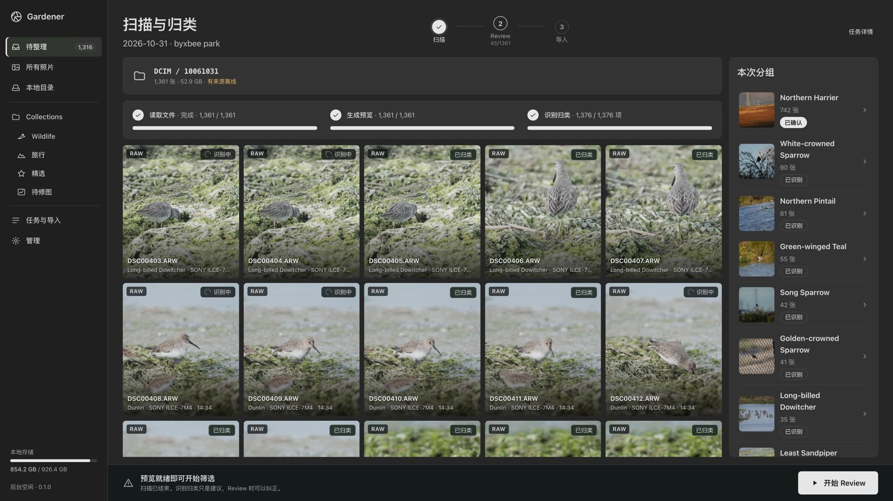
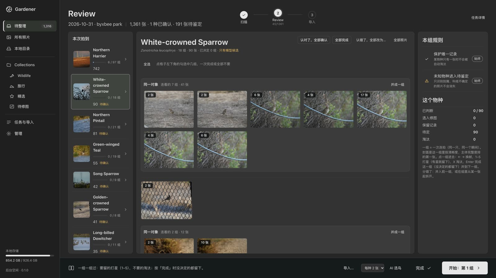
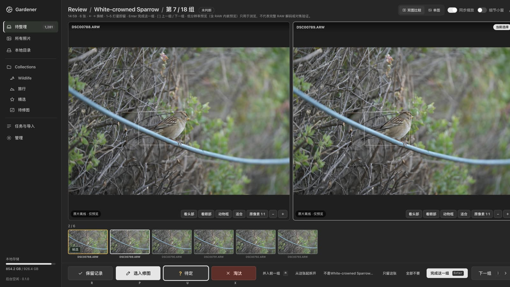
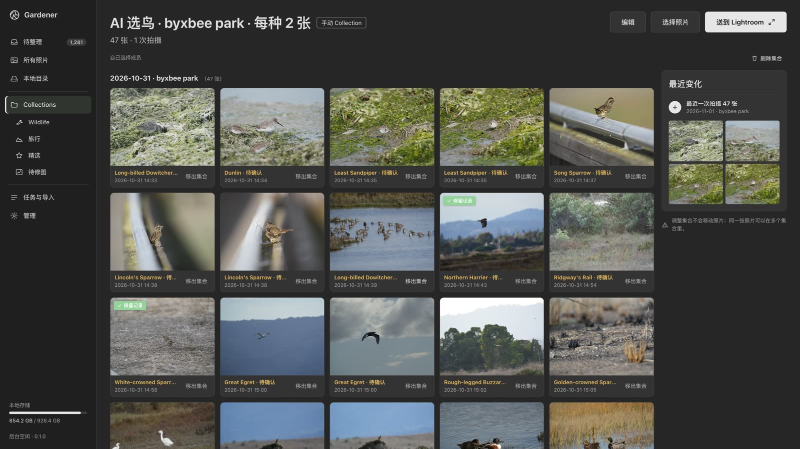

# Gardener

**English** | [简体中文](README.zh-CN.md)

### The photo album for people who shoot wildlife.

Gardener is a local album: point it at a folder and browse. Ask it to sort, and it finds the animals, names the species, groups the bursts, marks the good frames and puts the blurred and empty ones in a bin for you to check. Birds, mammals and every other animal go through the same steps. **No photo leaves the machine, and no file is touched unless you confirm it.**

https://github.com/user-attachments/assets/18bfad8b-6864-4edf-bb72-e1d05f7c075f

50 seconds, silent, Chinese captions. Every screen is the real UI on a real library of 3,554 photos. The UI is in Chinese for now; species show their scientific and English names.

## From a card to an album

<table>
<tr>
<td width="50%"><br><b>1. Add a folder.</b> 「加入图库」 only reads it and you browse at once; 「加入并自动归类」 also sorts it. Nothing is copied or moved.</td>
<td width="50%"><br><b>2. Review by species.</b> One burst is one group. Finish or reject many groups at once; a wrong name is corrected once for the whole shoot.</td>
</tr>
<tr>
<td><br><b>3. Compare.</b> Two frames side by side, zoomed to the head or the eye. Star what you keep. Every mark can be undone.</td>
<td><br><b>4. 好片 and 垃圾箱.</b> About a tenth of a shoot is offered as the good frames; the blurred and empty ones wait in the bin, and nothing leaves the disk until you empty it. Lightroom is optional.</td>
</tr>
</table>

- **Names you can check**: birds against AviList, mammals against MDD, every other animal against the TreeOfLife list, with a location prior from GPS.
- **Out, safely**: copy the keeps with checksums, hand stars and species keywords to Lightroom Classic, move the rejects you confirm to the Trash (recoverable).
- **Three front ends, one local service**: web UI, `gardener` CLI, MCP.

## Measured, not promised

**91.7% top-1 on birds, 91.0% on mammals**; when Gardener commits to a species it is right 97.1% / 96.5% of the time. iNaturalist golden set, California: 64 species, 1,571 research-grade photos with GPS, on an M-series Mac (2026-11-13).

| Group | Top-1 | Top-5 | Graded to species | Right when graded |
|---|---|---|---|---|
| Birds (1046) | 91.7% | 96.2% | 92.8% | 97.1% |
| Mammals (525) | 91.0% | 94.9% | 87.8% | 96.5% |

Aesthetic score against crowd stars (100 EVA photos): Spearman 0.877. GPS from a GPX track: median error 7 m on synthetic tracks. All tables and how they were measured: [docs/results.md](docs/results.md); the bars they are held to: [docs/standards.md](docs/standards.md).

Not measured yet: burst grouping, culling rules and the per-species picks on real albums; species outside birds and mammals beyond 18 test photos. The release gates in `docs/standards.md` are not all met. Known limits: [docs/how-it-works.md](docs/how-it-works.md#known-limitations-and-roadmap).

## Quick start

macOS on Apple Silicon; Python 3.12 with [`uv`](https://docs.astral.sh/uv/). About 10 GB of downloads, once.

```sh
git clone https://github.com/lincleejun/gardener && cd gardener
./scripts/install.sh                      # dependencies, name lists, model weights, name caches
uv run gardener serve                     # open http://127.0.0.1:8770; --port N, data in ~/.gardener ($GARDENER_HOME)
```

Or in Docker (any machine; on a Mac it runs on the CPU, about seven times slower than the native install):

```sh
PHOTOS=~/Pictures docker compose up -d    # first start downloads about 16 GB (17 min on a fast line); then open http://127.0.0.1:8770
```

`PHOTOS` is the one folder the container can read. Emptying the bin there moves files to `PHOTOS/.gardener-trash`. Details: [docs/usage.md](docs/usage.md#docker).

## The engine on its own

`gardener-engine` is the identification service and its CLI, usable without the workbench:

| Command | Does |
|---|---|
| `gardener-engine run DIR -r` | boxes and species per photo, graded species / genus / family / unconfirmed |
| `gardener-engine geotag DIR --gpx track.gpx` | GPS from a watch or phone track, written to XMP sidecars |
| `gardener-engine cull DIR -r --html review.html` | rejects with reasons, bursts with their best frame, picks per scene |
| `gardener-engine aesthetic score DIR --species --export html` | aesthetic ranking with names, as a review page |
| `gardener-engine eval`, `gardener-engine bench` | accuracy reports, baselines and regression budgets |

Every flag, the output schema and the HTTP API: [docs/usage.md](docs/usage.md).

## Documentation

| | |
|---|---|
| [docs/usage.md](docs/usage.md) | install, both CLIs, profiles and `gardener.toml`, Lightroom, HTTP API |
| [docs/gardener/](docs/gardener/) | the workbench: product brief, API contract, decisions |
| [docs/how-it-works.md](docs/how-it-works.md) | pipeline, grading rules, models and data with licences |
| [docs/album.md](docs/album.md), [docs/geotag.md](docs/geotag.md) | culling and aesthetics; GPX geotagging |
| [docs/development.md](docs/development.md), [docs/harness.md](docs/harness.md) | tests, CI, the evaluation harness |
| [CONTEXT.md](CONTEXT.md) | the terms used in code and docs |

## Formerly bioscan

Renamed in 2026-11. The `bioscan` command is now `gardener-engine`. `BIOSCAN_*` variables and `bioscan.toml` are still read (new names: `GARDENER_ENGINE_*`, `gardener.toml`). Names already on disk are unchanged: `~/.cache/bioscan`, the XMP `bioscan:` fields and the Lightroom plugin.

## License

Code: MIT ([LICENSE](LICENSE)). Models and data keep their own licences ([list](docs/how-it-works.md#pipeline)); the BirdNET location prior is CC BY-NC-SA 4.0, so check before commercial use.
