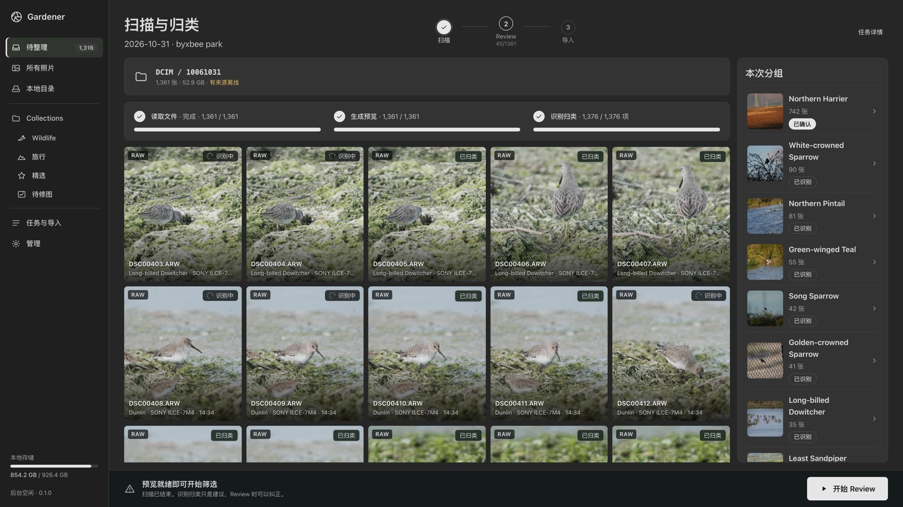
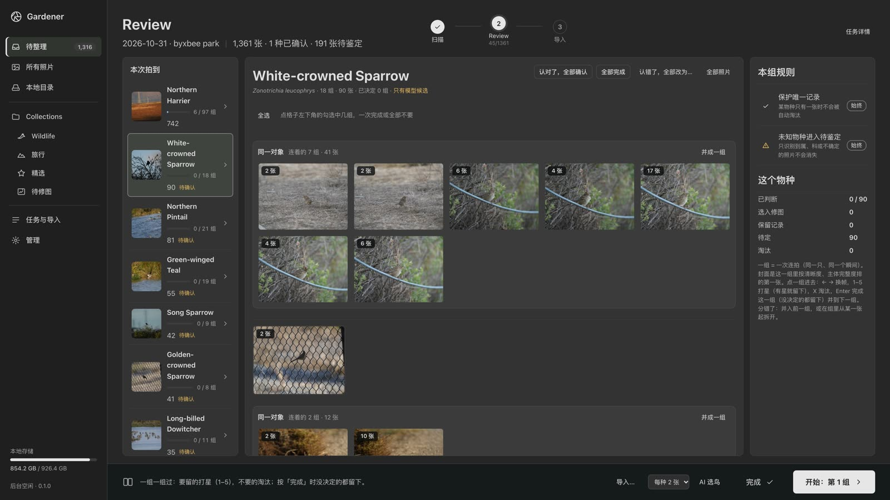
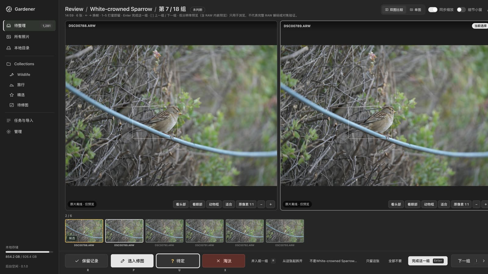
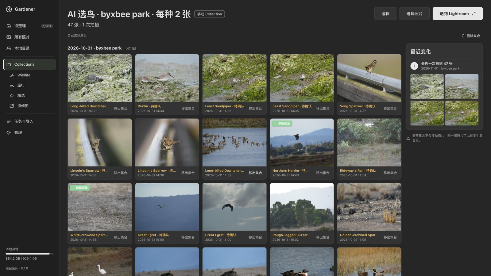

# Gardener

[English](README.md) | **简体中文**

### 拍野生动物的人的相册。

Gardener 是一个本地相册：指给它一个文件夹，就能浏览。让它归类，它会找出动物、认出物种、把连拍归成组、标出好片，把模糊的和没有主体的放进垃圾箱等你确认。鸟类、哺乳类和其他动物走同一套流程。**照片不出本机，不经你确认不动任何文件。**

https://github.com/user-attachments/assets/18bfad8b-6864-4edf-bb72-e1d05f7c075f

50 秒，无声，中文字幕。画面全部是真实界面，素材是一个 3,554 张的真实图库。

## 从一张卡到相册

<table>
<tr>
<td width="50%"><br><b>1. 加入文件夹。</b>「加入图库」只读取，马上能浏览；「加入并自动归类」同时归类。不复制、不移动任何文件。</td>
<td width="50%"><br><b>2. 按物种审片。</b>一次连拍是一组。可以一次完成或淘汰多组；认错的名字，整次拍摄改一次即可。</td>
</tr>
<tr>
<td><br><b>3. 比较。</b>两张并排，直接放大到头部或眼睛。要留的打星。每次标记都能撤销。</td>
<td><br><b>4. 好片和垃圾箱。</b>一次拍摄里大约十分之一会被挑成好片；模糊的和没有主体的进垃圾箱，清空之前文件都还在磁盘上。Lightroom 用不用由你。</td>
</tr>
</table>

- **名字有据可查**：鸟类对照 AviList，哺乳类对照 MDD，其他动物对照 TreeOfLife 名单，并用 GPS 做地点先验。
- **安全地输出**：带校验地复制留下的照片，把星级和物种关键词交给 Lightroom Classic，把你确认淘汰的移到废纸篓（可恢复）。
- **三个入口，一个本机服务**：网页、`gardener` 命令行、MCP。

## 实测，不是承诺

**鸟类首选正确率 91.7%，哺乳类 91.0%**；Gardener 定到种时，正确率是 97.1% / 96.5%。iNaturalist 标准集，加州：64 个物种，1,571 张带 GPS 的研究级照片，M 系列 Mac（2026-11-13）。

| 类群 | Top-1 | Top-5 | 定到种的比例 | 定到种时的正确率 |
|---|---|---|---|---|
| 鸟类（1046） | 91.7% | 96.2% | 92.8% | 97.1% |
| 哺乳类（525） | 91.0% | 94.9% | 87.8% | 96.5% |

美学评分对照大众星级（100 张 EVA 照片）：Spearman 0.877。GPX 轨迹补 GPS：合成轨迹上中位误差 7 米。全部表格和测量方法：[docs/results.md](docs/results.md)；对照的标准：[docs/standards.md](docs/standards.md)。

尚未实测：真实相册上的连拍分组、挑片规则和按物种挑片；鸟类和哺乳类之外的物种只测过 18 张照片。`docs/standards.md` 的发布门槛还没有全部达到。已知限制：[docs/how-it-works.md](docs/how-it-works.md#known-limitations-and-roadmap)。

## 快速开始

macOS，Apple Silicon（MPS）或 CPU；Python 3.12 和 `uv`。

```sh
git clone https://github.com/lincleejun/gardener && cd gardener
uv sync
uv run python tests/models/download.py    # 固定版本的权重，约 7 GB，只需一次
# 名单：下载 AviList 和 MDD 的 CSV，见 docs/usage.md#name-lists
uv run gardener-engine names stats        # 只需一次，联网：建立名单缓存（下载 3.26 GB）
uv run gardener serve                     # 打开 http://127.0.0.1:8770；--port N 换端口，数据在 ~/.gardener（$GARDENER_HOME）
```

## 单独使用识别引擎

`gardener-engine` 是识别服务和它的命令行，不开工作台也能用：

| 命令 | 作用 |
|---|---|
| `gardener-engine run DIR -r` | 每张照片的动物框和物种，定级为种 / 属 / 科 / 未确认 |
| `gardener-engine geotag DIR --gpx track.gpx` | 用手表或手机轨迹补 GPS，写入 XMP 旁车文件 |
| `gardener-engine cull DIR -r --html review.html` | 带理由的废片、连拍及其最佳帧、各场景的精选 |
| `gardener-engine aesthetic score DIR --species --export html` | 带物种名的美学排序，导出为审片页面 |
| `gardener-engine eval`、`gardener-engine bench` | 准确率报告、基线与回归预算 |

全部参数、输出格式和 HTTP API：[docs/usage.md](docs/usage.md)。

## 文档

| | |
|---|---|
| [docs/usage.md](docs/usage.md) | 安装、两个命令行、配置与 `gardener.toml`、Lightroom、HTTP API |
| [docs/gardener/](docs/gardener/) | 工作台：产品说明、API 契约、决策记录 |
| [docs/how-it-works.md](docs/how-it-works.md) | 流程、定级规则、模型与数据及其许可 |
| [docs/album.md](docs/album.md)、[docs/geotag.md](docs/geotag.md) | 挑片与美学；GPX 补 GPS |
| [docs/development.md](docs/development.md)、[docs/harness.md](docs/harness.md) | 测试、CI、评测工具 |
| [CONTEXT.md](CONTEXT.md) | 代码和文档里的术语 |

## 原名 bioscan

2026-11 改名。`bioscan` 命令现在是 `gardener-engine`。`BIOSCAN_*` 环境变量和 `bioscan.toml` 仍然有效（新名字：`GARDENER_ENGINE_*`、`gardener.toml`）。已经在磁盘上的名字不变：`~/.cache/bioscan`、XMP 里的 `bioscan:` 字段和 Lightroom 插件。

## 许可

代码：MIT（[LICENSE](LICENSE)）。模型和数据各有自己的许可（[列表](docs/how-it-works.md#pipeline)）；BirdNET 地点先验是 CC BY-NC-SA 4.0，商用前请自行确认。
